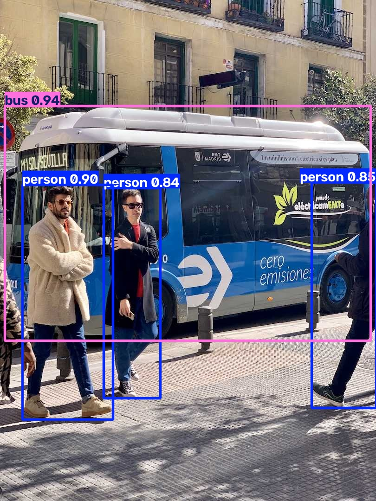
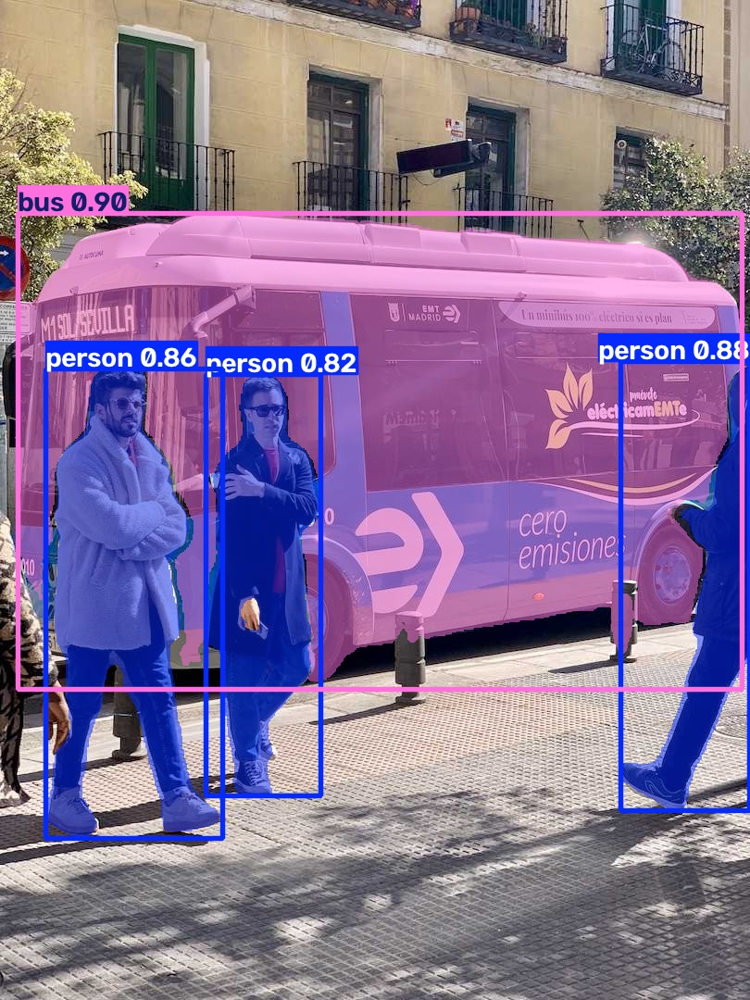
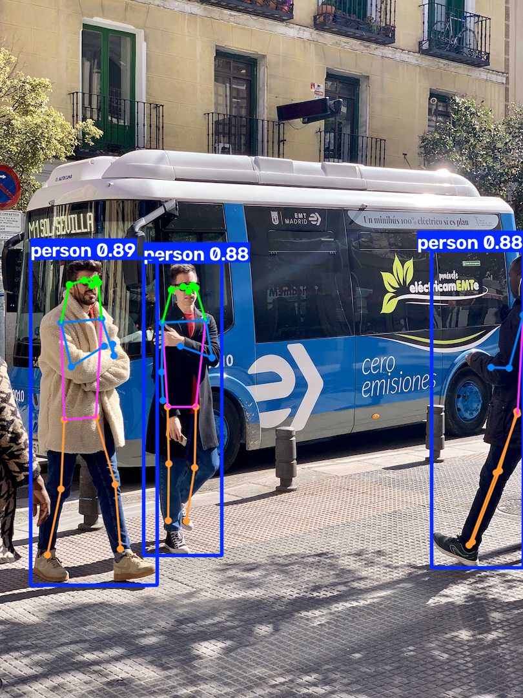
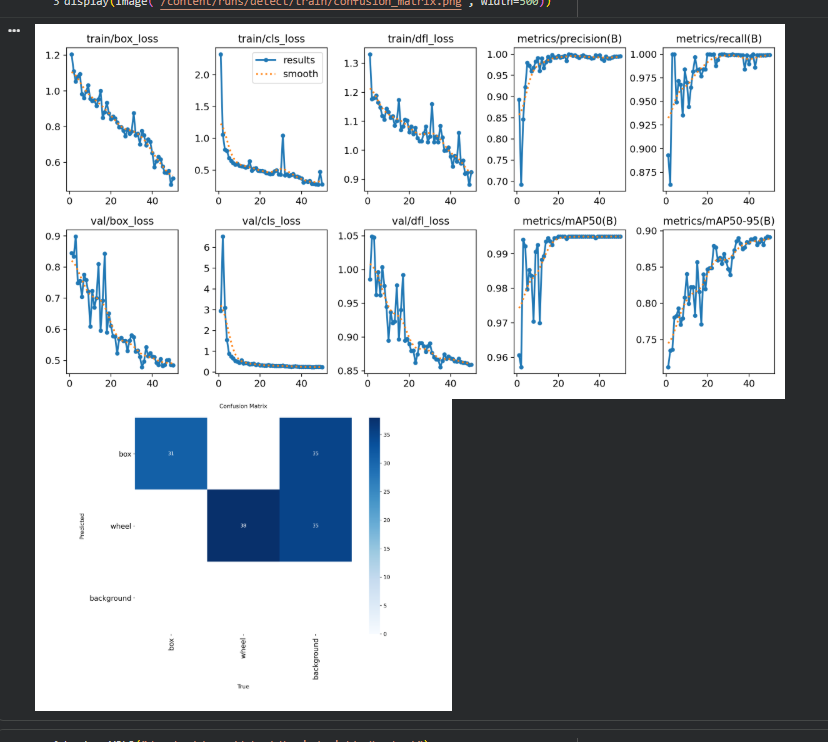
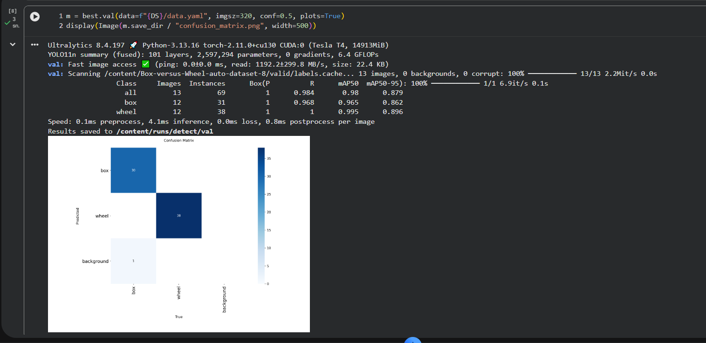
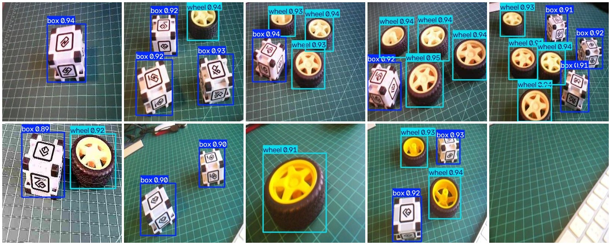
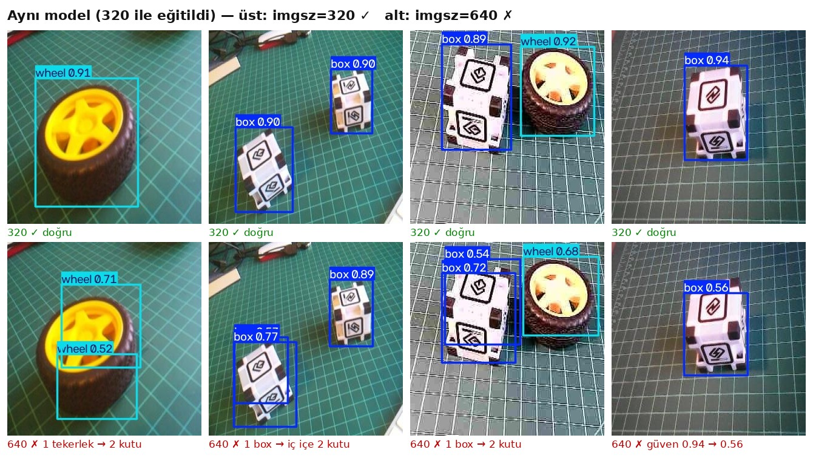

# 📘 Bölüm 6 — YOLO ile Nesne Tespiti: Colab'da Eğit, Raspberry Pi 5'te Çalıştır

> **Kaynak:** Marcelo Rovai — *Edge AI Engineering: Hands-On with the Raspberry Pi*, s. 218–262
> **Donanım:** Raspberry Pi 5 (4 GB) · Pi OS 64-bit (Debian, kernel 6.18) · Python 3.13
> **Eğitim:** Google Colab, Tesla T4 GPU · **Kütüphane:** Ultralytics 8.4.197
> **Hazırlayan:** Ebrar Kılıç — bu notlar hem kendi öğrenmem hem de öğrencilerim için yazıldı.

YOLO'nun teorisini (ızgara fikri, anchor-free tasarım, çıkış tensörünün matematiği, kayıp fonksiyonları, NMS) en baştan öğrenmek istersen önce **[YOLO: Sıfırdan Kahramana](yolo-sifirdan-kahramana.md)** dokümanını oku. Bu doküman ise **uygulamanın** adım adım kaydı: ne yaptık, neden yaptık, ekranda ne gördük, ondan ne öğrendik.

---

## İçindekiler
1. [Bu bölümde ne yapıyoruz?](#1-bu-bölümde-ne-yapıyoruz)
2. [Kurulum: PyTorch'un CPU tuzağı](#2-kurulum-pytorchun-cpu-tuzağı)
3. [İlk tahmin ve `Results` nesnesi](#3-i̇lk-tahmin-ve-results-nesnesi)
4. [Formatlar: PyTorch, NCNN, ONNX](#4-formatlar-pytorch-ncnn-onnx)
5. [YOLO'nun diğer görevleri: segment, pose, classify](#5-yolonun-diğer-görevleri)
6. [Kendi modelimiz: veri seti (Roboflow)](#6-kendi-modelimiz-veri-seti-roboflow)
7. [Colab'da eğitim ve log'u okumak](#7-colabda-eğitim-ve-logu-okumak)
8. [Grafikler, confusion matrix ve güven eşiği](#8-grafikler-confusion-matrix-ve-güven-eşiği)
9. [Modeli Pi'ye taşımak](#9-modeli-piye-taşımak)
10. [Pi'de ilk çıkarım (PyTorch, 320)](#10-pide-ilk-çıkarım)
11. [Deney: imgsz kuralını bozmak](#11-deney-imgsz-kuralını-bozmak)
12. [NCNN export'unu satır satır okumak](#12-ncnn-exportunu-satır-satır-okumak)
13. [PyTorch ve NCNN: hız ve doğruluk](#13-pytorch-ve-ncnn-hız-ve-doğruluk)
14. [Karşılaşılan hatalar ve çözümleri](#14-karşılaşılan-hatalar-ve-çözümleri)
15. [Mülakat soruları](#15-mülakat-soruları)
16. [Sözlük](#16-sözlük)

---

## 1. Bu bölümde ne yapıyoruz?

Bölüm 4'te COCO'da eğitilmiş **hazır** dedektörleri (SSD MobileNet, EfficientDet) LiteRT ile çalıştırmıştık. Bu bölümde iki büyük adım atıyoruz:

1. **YOLO ailesini tanımak:** Ultralytics kütüphanesiyle YOLOv8n, YOLO11n ve YOLO26n'i Pi 5'te çalıştırıp formatlarını karşılaştırmak.
2. **Kendi dedektörümüzü eğitip deploy etmek:** Hazır bir veri seti ile YOLO11n'i Colab GPU'sunda **box** ve **wheel** sınıfları için eğitmek, modeli Pi'ye taşımak, NCNN'ye çevirmek ve ölçmek.

```
Roboflow Universe          Google Colab (T4 GPU)                Raspberry Pi 5 (CPU)
─────────────────          ─────────────────────                ─────────────────────────────
Box vs Wheel v8     ──▶    yolo11n.pt + 50 epoch        ──▶     best.pt  (fp16, 5.3 MB)
225 train / 13 val         imgsz=320, ~2 dakika        scp          │  yolo export format=ncnn imgsz=320
10 test resmi              mAP50 0.995 / mAP50-95 0.897             ▼
                                                                NCNN (fp32, 10 MB) → 14.6 ms · 61 FPS
```

> **📝 Mülakat notu:** Bu akışın adı **"train in the cloud, infer at the edge"** (bulutta eğit, kenarda çalıştır). Eğitim çok hesap ister ve bir kez yapılır; çıkarım hafiftir ve milyonlarca kez yapılır. Edge AI'ın temel iş bölümü budur.

---

## 2. Kurulum: PyTorch'un CPU tuzağı

### 2.1 Ne kurduk?
```bash
python -m venv ~/yolo --system-site-packages     # picamera2 gibi sistem paketlerini de gör
source ~/yolo/bin/activate
mkdir -p ~/tmp && echo 'export TMPDIR=$HOME/tmp' >> ~/yolo/bin/activate   # büyük paketler için geçici klasör
pip install torch torchvision --index-url https://download.pytorch.org/whl/cpu
python -c "import torch; print(torch.__version__)"   # → ...+cpu görmelisin
pip install ultralytics
```

| Komut | Neden? |
|---|---|
| `--system-site-packages` | Pi OS'ta `picamera2` sistem paketi olarak kurulu. Venv bunu görsün diye |
| `TMPDIR=$HOME/tmp` | Pi OS'ta `/tmp` RAM üzerindedir (tmpfs). Büyük wheel dosyaları açılırken RAM dolmasın diye geçici klasörü SD karta alıyoruz |
| `--index-url .../whl/cpu` | ⭐ **En önemli satır.** PyTorch'un **CPU sürümünü** kurar |

### 2.2 Yaşadığımız hata: 3 GB'lık NVIDIA paketleri
İlk denemede iki şey üst üste geldi:
1. Terminale yapıştırırken **bracketed paste** karakterleri (`^[[200~` ve sondaki `~`) URL'yi bozdu, CPU index'i hiç kullanılmadı.
2. Sonra `pip install ultralytics`, PyTorch'u bağımlılık olarak varsayılan kaynaktan (PyPI) çekti. Linux'ta bu sürüm **CUDA'lı** ve yanında **~3 GB NVIDIA kütüphanesi** getiriyor. Pi'de NVIDIA GPU olmadığı için bunların hepsi işe yaramaz yük.

**Çözüm:**
```bash
deactivate
rm -rf ~/yolo ~/.cache/pip ~/tmp/*      # venv'i, pip önbelleğini ve geçici dosyaları sil
# sonra 2.1'deki adımlar, torch'u ultralytics'TEN ÖNCE kurarak
```
**Ders:** pip, bir paket zaten kuruluysa onu yeniden indirmez. Bu yüzden `torch`'u **önce, doğru kaynaktan** kurmak, ultralytics'in yanlış sürümü çekmesini engeller.

> **📝 Mülakat notu:** "Kurulum sırası önemli mi?" Evet. Bağımlılık çözücü, ihtiyacı zaten karşılanmış paketlere dokunmaz. Donanıma özel sürümleri (CPU/CUDA/ROCm torch, ARM wheel'leri) **önce** kurmak yaygın bir tekniktir.

---

## 3. İlk tahmin ve `Results` nesnesi

`explore_results.py`, YOLO'nun döndürdüğü nesneyi tanımak için yazıldı:
```python
model = YOLO("models/yolo11n_ncnn_model", task="detect")
r = model.predict("images/bus.jpg", imgsz=640, conf=0.5, verbose=False)[0]
```

| Alan | İçerik | Format |
|---|---|---|
| `r.boxes.xyxy` | Kutu köşeleri | **piksel**, `[x1, y1, x2, y2]` (orijinal resim boyutunda) |
| `r.boxes.xyxyn` | Kutu köşeleri | **0–1 normalize** |
| `r.boxes.xywh` | Merkez + boyut | piksel, `[xc, yc, w, h]` |
| `r.boxes.conf` | Güven skoru | 0–1 |
| `r.boxes.cls` | Sınıf numarası | float olarak tam sayı |
| `r.boxes.data` | Hepsi bir tabloda | `[x1, y1, x2, y2, conf, cls]` |
| `r.names` | Numara → isim sözlüğü | `{0: 'person', 5: 'bus', ...}` |
| `r.orig_shape` | Orijinal resim boyutu | `(H, W)` |
| `r.speed` | Süreler (ms) | `preprocess / inference / postprocess` |

### Üç kutu formatı: karıştırma!
| Nerede? | Format | Örnek |
|---|---|---|
| SSD / EfficientDet (Bölüm 4) | `[ymin, xmin, ymax, xmax]`, **normalize** | `[0.21, 0.05, 0.89, 0.40]` |
| YOLO çıktısı (`xyxy`) | `[x1, y1, x2, y2]`, **piksel** | `[48, 230, 245, 795]` |
| YOLO etiket dosyası (`.txt`) | `[sınıf, xc, yc, w, h]`, **normalize** | `0 0.43 0.52 0.20 0.31` |

> **📝 Mülakat notu:** Nesne tespitinde en sık yapılan hata **koordinat sırasını** (y önce mi x önce mi?) ve **ölçeği** (piksel mi normalize mi?) karıştırmaktır. Program çökmez, kutular sadece yanlış yere çizilir.

---

## 4. Formatlar: PyTorch, NCNN, ONNX

Aynı modeli (`bus.jpg`, 640×640) üç formatta ölçtük: `bench_yolo.py`. Her model için **3 ısınma + 10 ölçüm**, ortalama ± standart sapma.

| Model | Format | Inference (ms) | Postprocess (ms) | PyTorch'a göre | Tespitler |
|---|---|---|---|---|---|
| YOLOv8n | PyTorch | 308.8 ± 0.4 | 1.4 | ×1.0 | 1 bus, 4 person |
| YOLOv8n | **NCNN** | **71.8 ± 0.2** | 1.7 | **×4.3** | 1 bus, 4 person |
| YOLO11n | PyTorch | 293.0 ± 0.7 | 1.4 | ×1.0 | 1 bus, 4 person |
| YOLO11n | **NCNN** | **69.9 ± 0.3** | 1.7 | **×4.2** | 1 bus, 4 person |
| YOLO26n | PyTorch | 270.3 ± 0.7 | 1.4 | ×1.0 | 1 bus, 4 person |
| YOLO26n | **NCNN** | **66.1 ± 0.4** | 1.8 | **×4.1** | 1 bus, 4 person |
| YOLO26n | ONNX Runtime | 125.0 ± 0.2 | 3.8 | ×2.2 | 1 bus, 4 person |

*Raspberry Pi 5 (4 GB), 640×640, 3 ısınma + 10 ölçüm. Bütün modeller aynı 5 nesneyi buldu.*

```
YOLOv8n  PyTorch ████████████████████████████████ 308.8
         NCNN    ███████▌                           71.8
YOLO11n  PyTorch ██████████████████████████████▍  293.0
         NCNN    ███████▎                           69.9
YOLO26n  PyTorch ████████████████████████████      270.3
         NCNN    ██████▉                            66.1
         ONNX    █████████████                     125.0
```
- Nesilden nesle model biraz hızlanıyor (v8n → 11n → 26n: 308.8 → 293.0 → 270.3 ms, PyTorch).
- Standart sapmalar ±1 ms'nin altında: ısınma sonrası ölçümler **çok kararlı**.

**Bulgular:**
- **NCNN, her modelde PyTorch'tan ×4.1–4.3 hızlı.** NCNN, ARM işlemcilerin **NEON** vektör komutları için optimize edilmiş bir çıkarım motoru; PyTorch ise eğitim için tasarlanmış genel amaçlı bir kütüphane.
- **ONNX Runtime bu kurulumda NCNN'den yavaştı.** Kitaptaki Pi Zero sonuçları farklıydı. Hangi motorun en hızlı olduğu **donanıma** bağlı; genelleme yapma, **ölç**.
- **YOLO26 NMS'siz (end-to-end).** Postprocess süresinin ilk (soğuk) çalıştırmalarda yanıltıcı olabildiğini de öğrendik: Isınma yapılmadan alınan ölçümlerden "NMS'siz olduğu için hızlı" sonucunu çıkarmak **yanlıştı**. Adil ölçüm için ısınma şart.

---

## 5. YOLO'nun diğer görevleri

Aynı Ultralytics API'si dört görevi de yapar; sadece model dosyası değişir (`yolo_tasks.py`):

| Görev | Model | Ek çıktı | Ne işe yarar? |
|---|---|---|---|
| **detect** | `yolo11n.pt` | `boxes` | Nesne + kutu |
| **segment** | `yolo11n-seg.pt` | `masks` (piksel maskeleri) | Nesnenin **tam şekli** |
| **pose** | `yolo11n-pose.pt` | `keypoints` (kişi başına 17 nokta: burun, gözler, omuzlar…) | İnsan **duruşu** |
| **classify** | `yolo11n-cls.pt` | `probs` (ImageNet 1000 sınıf) | Tüm resme tek etiket |

| Görev | Süre (PyTorch, 640) | Çıktı |
|---|---|---|
| 🎭 segment | 433 ms | 4 nesne · `masks.data` → (4, 640, 480): nesne başına bir piksel maskesi |
| 🕺 pose | 330 ms | 3 kişi · `keypoints.data` → (3, 17, 3): kişi × 17 eklem × (x, y, görünürlük) |
| 🏷️ classify | 49 ms | top-5: minibus %57, police_van %34, trolleybus %4, recreational_vehicle %1, streetcar %1 |

- **segment detect'ten yavaş** (433 ms ve 293 ms): Kutuların yanında her nesne için bir maske de üretiliyor.
- **classify çok hızlı** (49 ms): Kutu veya maske yok, resim başına tek bir vektör; ayrıca varsayılan giriş 224×224.
- 1. kişinin burnu: `[142.3, 442.0, 0.99]` → görünürlük 0.99, yani burun net görünüyor.
- Sınıflandırıcı "bus" değil **minibus** dedi: ImageNet'in 1000 sınıfında "school bus", "minibus", "trolleybus" gibi ince ayrımlar var; tek etiketli sınıflandırmanın sınırı (Bölüm 2'deki dersin aynısı).

<p align="center">
  <br>
<i>Aynı resim: detect · segment · pose</i>
</p>

Keypoint formatı: Her nokta `(x, y, görünürlük)`. Görünürlük düşükse o eklem resimde görünmüyor (örneğin arkası dönük bir kişinin burnu).

---

## 6. Kendi modelimiz: veri seti (Roboflow)

### 6.1 Neden hazır veri seti?
Proje 3'te (Bölüm 5) kendi verimizi toplayıp etiketleyeceğiz. Bu bölümde amaç **YOLO eğitim akışını** öğrenmek olduğu için kitabın veri setini kullandık: **Roboflow Universe → `marcelo-rovai-riila / box-versus-wheel-auto-dataset`, sürüm 8**.

| Terim | Açıklama |
|---|---|
| **Roboflow** | Veri seti etiketleme, sürümleme ve dışa aktarma platformu |
| **Universe** | Roboflow'un herkese açık veri seti kütüphanesi |
| **Version (sürüm)** | Veri setinin dondurulmuş bir hali: hangi resimler, hangi ön işleme, hangi augmentation. Aynı sürüm hep aynı veriyi verir → **tekrarlanabilirlik** |
| **Export format** | Etiketlerin yazıldığı biçim. Biz **YOLOv11** formatını seçtik |

### 6.2 YOLO veri seti klasör yapısı
```
Box-versus-Wheel-auto-dataset-8/
├── data.yaml
├── train/ images/*.jpg   labels/*.txt      ← 225 resim
├── valid/ images/        labels/           ←  13 resim
└── test/  images/        labels/           ←  10 resim
```
Her resmin **aynı adlı** bir `.txt` etiket dosyası var. Her satır bir nesne:
```
0 0.4312 0.5207 0.1984 0.3125      → sınıf 0 (box), merkez (0.43, 0.52), boyut 0.20 × 0.31
```
**Boş etiket dosyası = background resmi:** Resimde hiç nesne yok. Modele "buraya kutu çizme" öğretir.

### 6.3 Augmentation iki katmanda
| Nerede? | Ne zaman? | Örnek |
|---|---|---|
| **Roboflow** | Eğitimden **önce**, diske yazılır | 75 orijinal → 225 eğitim resmi (×3) |
| **Ultralytics** | Eğitim **sırasında**, her epoch'ta farklı | mosaic, flip, HSV, scale, translate, erasing |

### 6.4 API anahtarı güvenliği 🔐
Roboflow indirme kodu bir **API anahtarı** içerir. Bu anahtar hesabının şifresi gibidir:
- GitHub'a **yükleme**, ekran görüntüsünde **gösterme**, defteri "bağlantıya sahip herkes" modunda **paylaşma**.
- Colab'da **🔑 Secrets** bölümüne koy ve `userdata.get("ROBOFLOW_API_KEY")` ile oku.
- Yanlışlıkla paylaştıysan Roboflow'da anahtarı **yenile (revoke)**.

---

## 7. Colab'da eğitim ve log'u okumak

### 7.1 Kod
```python
model = YOLO("yolo11n.pt")       # COCO ağırlıklarıyla başla → transfer learning
results = model.train(data=f"{DS}/data.yaml", epochs=50, imgsz=320, plots=True)
```
`data.yaml`'ı **mutlak yollarla** yeniden yazdık (`path: /content/Box-versus-Wheel-auto-dataset-8`). Roboflow'un göreli yolları bazen Ultralytics'in yanlış klasöre bakmasına yol açar.

### 7.2 Log'daki kritik satırlar
| Log satırı | Anlamı |
|---|---|
| `CUDA:0 (Tesla T4, 14913MiB)` | Eğitim GPU'da ✅ |
| `Overriding model.yaml nc=80 with nc=2` | Head, COCO'nun 80 sınıfından bizim 2 sınıfımıza değiştirildi |
| `Transferred 493/499 items` | 499 ağırlık grubundan 493'ü COCO'dan kopyalandı. Kalan 6'sı sınıf head'i, **sıfırdan** öğrenilecek |
| `Freezing layer 'model.23.dfl.conv.weight'` | DFL katmanı sabit bir dönüşüm; öğrenilmez |
| `AMP: checks passed ✅` | **Mixed precision** (16+32 bit) eğitim açık → daha hızlı |
| `225 images, 12 backgrounds, 0 corrupt` | 12 boş resim var (iyi), bozuk dosya yok |
| `WARNING ... len(segments) = 12, len(boxes) = 675` | 12 etiket kutu değil **çokgen**. Ultralytics sadece kutuları kullanır; zararsız ama veri setinde küçük bir tutarsızlık |
| `optimizer: AdamW(lr=0.001667, momentum=0.9)` | `optimizer=auto`, küçük veri ve kısa eğitim için AdamW seçti |
| `Closing dataloader mosaic` (epoch 41) | `close_mosaic=10`: son 10 epoch'ta mosaic kapatılır, model gerçek resimlere uyum sağlar |
| `50 epochs completed in 0.032 hours` | ~2 dakika ⚡ |
| `Optimizer stripped ... best.pt, 5.5MB` | Optimizer durumu silindi ve ağırlıklar **fp16**'ya çevrildi → küçük dosya |
| `YOLO11n summary (fused): 101 layers` | Conv + BatchNorm birleştirildi (181 → 101 katman) |

### 7.3 Model mimarisi (YOLO11n)
```
GİRİŞ 320×320×3
  │  BACKBONE (katman 0–10): Conv, C3k2, SPPF, C2PSA   → "ne görüyorum?" (320→10 piksel, 16→256 kanal)
  │  NECK     (katman 11–22): Upsample + Concat        → farklı ölçekleri birleştir (FPN/PAN)
  ▼  HEAD     (katman 23): Detect                      → 3 ölçekte (stride 8/16/32) kutu + sınıf
2,590,230 parametre · 6.5 GFLOPs @640 (1.6 GFLOPs @320)
```

### 7.4 Eğitim nasıl ilerledi?
| Epoch | box_loss | cls_loss | dfl_loss | P | R | mAP50 | mAP50-95 |
|---|---|---|---|---|---|---|---|
| 1 | 1.206 | 2.322 | 1.331 | 0.893 | 0.893 | 0.961 | 0.712 |
| 3 | 1.053 | 0.822 | 1.180 | 0.846 | 1.000 | 0.994 | 0.736 |
| 10 | 0.957 | 0.571 | 1.131 | 0.991 | 0.970 | 0.993 | 0.841 |
| 25 | 0.797 | 0.439 | 1.031 | 1.000 | 0.994 | 0.995 | 0.859 |
| 40 | 0.652 | 0.372 | 0.978 | 0.997 | 0.990 | 0.995 | 0.884 |
| 50 | 0.511 | 0.277 | 0.924 | 0.995 | 0.999 | 0.995 | 0.891 |

**Beş ders:**
1. **Transfer learning'in gücü:** 1. epoch'ta bile mAP50 = 0.961.
2. **`cls_loss` en hızlı düştü** (2.32 → 0.82, 3 epoch): Yeni head rastgele başladı ama box/wheel ayrımı görsel olarak kolay.
3. **mAP50 erken doydu, mAP50-95 yükselmeye devam etti:** Model önce "nerede ne var?" sorusunu çözdü, sonra kutuları **sıkılaştırmayı** öğrendi.
4. **Mosaic kapanınca (epoch 41) kayıplar aniden düştü:** Görev kolaylaştı (gerçek, tek resimler).
5. **Zıplamalar normal:** Epoch 31'deki `cls_loss` sıçraması zor bir batch'ti; genel eğilim aşağı.

### 7.5 Final doğrulama (best.pt)
| Sınıf | Resim | Nesne | P | R | mAP50 | mAP50-95 |
|---|---|---|---|---|---|---|
| **all** | 13 | 69 | 0.995 | 0.999 | **0.995** | **0.897** |
| box | 12 | 31 | 1.000 | 0.998 | 0.995 | 0.897 |
| wheel | 12 | 38 | 0.989 | 1.000 | 0.995 | 0.897 |

T4'te çıkarım: ilk ölçümde 15.3 ms, GPU ısındıktan sonra **4.1 ms**.

⚠️ Doğrulama kümesi sadece **13 resim**. Tek bir hata metrikleri ~%1.5 oynatır. Gerçek projede daha büyük val/test kümesi gerekir.

---

## 8. Grafikler, confusion matrix ve güven eşiği

<p align="center"></p>

### 8.1 Grafikler (`results.png`)
- `train/box_loss` ve `val/box_loss` **birlikte düşüyor**, val sonda yükselmiyor → **overfitting yok**.
- `val/cls_loss` epoch 2'de 6.5'e fırlayıp hemen düşüyor: yeni head'in ilk karmaşası.
- Metrik eğrilerindeki zikzaklar, 13 resimlik küçük doğrulama kümesinin gürültüsü.

**Overfitting'in imzası:** train loss düşmeye devam ederken val loss **yükselmeye başlar** ("makas açılır").

### 8.2 Confusion matrix: aynı model, iki eşik
| | conf = 0.001 (val varsayılanı) | conf = 0.5 (çalışma noktası) |
|---|---|---|
| Doğru box / wheel | 31/31 · 38/38 | **30**/31 · 38/38 |
| Yanlış alarm (background **sütunu**) | ~35 + ~35 | **0** ✅ |
| Kaçırma (background **satırı**) | 0 | **1 box** |
| mAP50 / mAP50-95 | 0.995 / 0.897 | 0.98 / 0.879 |

<p align="center"></p>

**Dersler:**
1. **Precision–recall takası:** Eşik düşükse her şeyi yakalarsın ama çöp kutular da gelir; eşik yüksekse yanlış alarm biter ama bazı nesneler kaçar.
2. **mAP'i düşük eşikle raporla:** mAP, tüm eşiklerin üzerinden çizilen PR eğrisinin altındaki alandır. conf=0.5'te eğrinin ucu kesilir ve mAP yapay olarak düşer.
3. **Precision/recall ve confusion matrix tek bir eşikte ölçülür.** Bir sayı görünce "hangi eşikte?" diye sor.

### 8.3 Test kümesi (modelin hiç görmediği 10 resim)
<p align="center"></p>

Kutular sıkı, skorlar 0.89–0.95, eğik nesneler ve birbirine yakın tekerlekler doğru ayrılmış. Son resim (`121009`) boş masa: Model doğru şekilde **hiçbir şey çizmedi**; klavyenin beyaz tuşlarını box sanmadı.

⚠️ Test resimleri eğitimle aynı ortamdan (aynı mat, ışık, nesneler). Farklı bir sahnede performans düşebilir: **domain shift**.

---

## 9. Modeli Pi'ye taşımak

```powershell
# 💻 Windows (İndirilenler klasöründe)
C:\Windows\Sysnative\OpenSSH\scp.exe best.pt pi@raspi-5.local:Documents/YOLO/models/box_wheel_320_yolo11n.pt
```
- **scp:** SSH üzerinden şifreli dosya kopyalama.
- **Anlamlı ad:** `box_wheel` (görev) `_320` (imgsz) `_yolo11n` (temel model). `_320`, export sırasında imgsz'yi hatırlatan ilk koruma.
- **"authenticity of host can't be established":** Pi'ye ilk kez `raspi-5.local` adıyla bağlandık. SSH, parmak izinin daha önce `192.168.1.42` için kaydedilenle **aynı** olduğunu söyledi → güvenli.
- **Boyut kontrolü:** `dir` → 5,465,626 bayt; scp → 5338 KB (= 5,465,626 / 1024) ✅

> **📝 Mülakat notu:** "REMOTE HOST IDENTIFICATION HAS CHANGED" uyarısı ya cihazın yeniden kurulduğunu ya da bir **man-in-the-middle** saldırısını gösterir. Körü körüne geçilmez.

**Prompt'a bak:** `PS C:\...>` = Windows, `pi@raspi-5:~ $` = Pi. Linux komutunu (`ls -lh`) Windows'ta yazınca PowerShell'in `ls` takma adı (`Get-ChildItem`) hata verdi.

Test resimleri için Colab'da `zip -j` ile 10 resmi zip'leyip aynı yoldan Pi'ye taşıdık ve `unzip -d images/box_wheel_test` ile açtık.

---

## 10. Pi'de ilk çıkarım

`predict_box_wheel.py` (varsayılan `imgsz=320`, `conf=0.5`, 3 ısınma):

| Sonuç | Değer |
|---|---|
| Sınıflar | `{0: 'box', 1: 'wheel'}`, `best.pt`'nin içinden geldi (ayrı labels dosyasına gerek yok) |
| Toplam tespit | **14 box, 16 wheel** |
| Ortalama çıkarım | **101.3 ms** (≈ 10 FPS) |
| Colab ile karşılaştırma | İlk 3 resimde kutu sayıları ve skorlar **birebir aynı** ✅ |

**Gözlemler:**
- **Süre nesne sayısından bağımsız** (100.8–102.2 ms): Model her resimde 2100 adayın hepsini hesaplar. Bu, gerçek zamanlı sistemler için değerli bir **öngörülebilirlik**.
- **Training/serving skew yok:** Model GPU'dan CPU'ya taşınınca sonuçlar değişmedi.
- **Kayıt yolu tuzağı:** `project="runs"` (göreli yol) verince Ultralytics çıktıyı `runs/detect/runs/...` altına koydu. Çözüm: `Path("runs").resolve()` ile **mutlak yol**.

---

## 11. Deney: imgsz kuralını bozmak

**Kural:** *Model hangi boyutla eğitildiyse, export ve çıkarım da o boyutla yapılmalı.*

Aynı `.pt` modelini bilerek 640 ile çalıştırdık (`python predict_box_wheel.py 640`):

| | imgsz = 320 ✅ | imgsz = 640 ❌ |
|---|---|---|
| Süre | 101 ms | **385 ms** (×3.8) |
| Skorlar | 0.89–0.95 | 0.52–0.93 |
| Toplam tespit | 14 box, 16 wheel | 16 box, 17 wheel (**+3 hayalet**) |
| Örnek | `00000`: box 0.94 | `00000`: box **0.56** |

<p align="center"></p>

### Neden?
1. **CNN'ler nesneleri piksel ölçeğinde öğrenir.** 640'ta her nesne 2 kat büyük görünür; filtreler alışık olmadıkları bir ölçekle karşılaşır. Ayrıca test resimleri zaten 320×320; 640'a büyütmek bilgi eklemez, sadece **upscaling** yapar.
2. **Augmentation'daki `scale=0.5`** ±%50'yi kapsar; ×2 (+%100) bu aralığın dışında.
3. **Ölçek haritası kayması:** Nesneler stride 8/16/32 haritaları arasında başka bir haritaya kayar.
4. **Parçalanma:** Nesne o kadar büyür ki **parçaları** (jant, lastik) tek başına "bütün nesne" boyutuna yaklaşır → bir tekerleğe 2 kutu.
5. **NMS bu kopyaları silemez:** Parça kutuları az örtüşür (IoU düşük); NMS onları "farklı nesneler" sanar.

**Süre neden ×3.8?** Piksel ×4 → hesap (GFLOPs) ×4 (6.4 / 1.6). PyTorch'un sabit yönetim yükü toplamın yalnızca ~%5'i.

> **📝 Mülakat notu:** "Bir nesneye iki kutu çiziliyor" hatasında ilk kontrol: **eğitim ve çıkarım çözünürlükleri aynı mı?** Bu hata sessizdir: program çökmez, sadece sonuçlar kötüleşir. Sayma uygulamalarında (Bölüm 7) doğrudan **yanlış sayı** demektir.

---

## 12. NCNN export'unu satır satır okumak

```bash
yolo export model=models/box_wheel_320_yolo11n.pt format=ncnn imgsz=320
```
5.6 saniyede bitti. Önemli satırlar:

| Log | Anlamı |
|---|---|
| `torch-2.15.0+cpu ... CPU (aarch64)` | CPU PyTorch, 64-bit ARM |
| `fused ... 0 gradients, 1.6 GFLOPs` | Çıkarım modu; hesap 320 için (640'ta 6.4) |
| `input shape (1, 3, 320, 320) BCHW` | Batch 1, 3 kanal, 320×320, **kanal önde** (LiteRT ise NHWC) |
| `output shape(s) (1, 6, 2100)` | 6 = 4 kutu + 2 sınıf · 2100 = aday kutu sayısı |
| `NCNN ... and PNNX ...` | Dönüşüm zinciri: PyTorch → trace → TorchScript → **PNNX** → NCNN |
| `FutureWarning: torch.jit.trace is deprecated` | Uyarı, hata değil |
| `fp16 = 0` | Ağırlıklar **fp32** yazıldı |
| `inline module = ...C3k2` | Python modülleri temel işlemlere açıldı (NCNN "C3k2" bilmez) |
| `pass_level1 ... pass_level5` | Grafik optimizasyonu: constant folding, operator fusion, dead code elimination |
| `export success ✅ 5.3s ... (10.0 MB)` | Bitti |

### 2100 nereden geliyor?
| Ölçek | Stride | Harita | Aday |
|---|---|---|---|
| P3 (küçük nesneler) | 8 | 40×40 | 1600 |
| P4 (orta) | 16 | 20×20 | 400 |
| P5 (büyük) | 32 | 10×10 | 100 |
| | | **Toplam** | **2100** |

640'ta: 80² + 40² + 20² = **8400**. Çıkış katmanı bu sayıya **sabitlendiği** için imgsz modelin içine gömülüdür.

### Neden NCNN 10 MB, `.pt` 5.3 MB?
```
2,597,294 parametre × 4 bayt (fp32) = 10.4 MB  ← NCNN .bin
2,597,294 parametre × 2 bayt (fp16) =  5.2 MB  ← best.pt (Ultralytics kaydederken fp16'ya çevirir)
```

### `metadata.yaml`
```yaml
stride: 32            # imgsz 32'nin katı olmalı
task: detect
batch: 1
imgsz: [320, 320]     # ⭐ imgsz kuralı korundu
names: {0: box, 1: wheel}
args: {quantize: null}   # int8 yok, fp32
end2end: false        # YOLO11 NMS gerektirir (YOLO26: true)
license: AGPL-3.0     # ticari dağıtımda dikkat!
```

---

## 13. PyTorch ve NCNN: hız ve doğruluk

`bench_box_wheel.py`: 10 resim × 3 tur = 30 ölçüm, 5 ısınma, `imgsz=320`, `conf=0.5`.

| Model | pre | **inf** | post | **toplam** | **FPS** |
|---|---|---|---|---|---|
| PyTorch | 0.7 ms | 103.0 ms | 0.9 ms | 104.6 ms | 9.6 |
| **NCNN** | 0.7 ms | **14.6 ms** | 1.0 ms | **16.3 ms** | **61.4** |

- **Çıkarım hızlanması ×7.1, toplam hızlanma ×6.4.** Fark **Amdahl yasası**: hızlanmayan pre+post (1.7 ms) NCNN'de toplamın %10'u oldu.
- **640'ta ×4.2 (YOLO11n, `bus.jpg`) iken 320'de ×7.1.** Olası sebepler (hipotez): küçük ara haritaların CPU önbelleğine sığması; PyTorch'un küçük işlerde çok çekirdekli paralellik verimini kaybetmesi. **Hızlanma oranı model, giriş boyutu ve donanıma bağlıdır; ölç.**
- **Doğruluk: 10/10 resimde nesne sayıları aynı, skor farkı ≤ 0.01.** Fark fp16 (`.pt`) ve fp32 (NCNN) hassasiyetinden ve yuvarlamadan geliyor. int8 quantization yapılsaydı bu kontrol **zorunlu** olurdu.

```
Pi 5 CPU   PyTorch 640 ──── 385 ms ████████████████████████████████████████
           PyTorch 320 ──── 103 ms ███████████
           NCNN    320 ──── 14.6 ms █▌
T4 GPU     PyTorch 320 ──── 4.1 ms  ▌
```

---

## 14. Karşılaşılan hatalar ve çözümleri

| Belirti | Sebep | Çözüm |
|---|---|---|
| pip ~3 GB NVIDIA paketi indiriyor | ultralytics, CUDA'lı torch'u PyPI'dan çekti | venv'i sil, **önce** `torch` CPU index'ten, sonra ultralytics |
| URL'de `^[[200~` ve `~` | Terminalde bracketed paste | Komutu elle düzelt ya da tek satır yapıştır |
| Python 3.13 REPL'de çok satırlı yapıştırma çıktı vermedi | Yeni REPL'in yapıştırma davranışı | Kodu `.py` betiğine yaz |
| Roboflow polygon uyarısı | 12 etiket çokgen | Zararsız; Ultralytics kutu kullanır |
| `runs/detect/runs/...` klasörü | Göreli `project` yolu | `Path("runs").resolve()` |
| `ls -lh` → `Get-ChildItem` hatası | Komut Windows'ta yazıldı | Önce `ssh` ile Pi'ye bağlan |
| 640'ta parça kutular, düşük skor | imgsz uyuşmazlığı | Eğitim = export = çıkarım imgsz |
| Confusion matrix'te ~70 yanlış alarm | Val varsayılanı conf=0.001 | Çalışma eşiğiyle (`conf=0.5`) yeniden doğrula |

---

## 15. Mülakat soruları

1. **YOLO çıkışındaki 8400 sayısı nereden gelir?** → 640 girişte stride 8/16/32 haritalarının hücre toplamı: 80² + 40² + 20².
2. **mAP50 ile mAP50-95 farkı?** → mAP50 tek IoU eşiğinde (0.5) "nesneyi buldu mu?" sorusunu, mAP50-95 ise 0.5–0.95 arası 10 eşiğin ortalamasıyla **kutu hassasiyetini** ölçer.
3. **Precision yüksek, recall düşük; ilk ne yaparsın?** → Güven eşiğini düşür (bedava); yetmezse veri/eğitim.
4. **Overfitting'i grafikten nasıl anlarsın?** → train loss düşerken val loss yükselir.
5. **best.pt ile last.pt farkı?** → En iyi doğrulama skorlu epoch / son epoch.
6. **Neden 320 ile eğitilmiş modeli 640'ta çalıştırmamalıyız?** → Ölçek uyuşmazlığı: düşük güven, parça kutular, ×4 yavaşlık.
7. **NCNN neden Pi'de PyTorch'tan hızlı?** → Çıkarıma özel, ARM NEON için optimize, Python/gradyan yükü yok, grafik optimizasyonu.
8. **Model 7 kat hızlandı, sistem neden 7 kat hızlanmadı?** → Amdahl yasası.
9. **Export sonrası neyi doğrularsın?** → Hız **ve** aynı resimlerde aynı tespitler (sayı, skor farkı); metadata (imgsz, names).
10. **YOLO11 ile YOLO26 farkı?** → YOLO26 end-to-end (NMS'siz); YOLO11 NMS gerektirir (`end2end: false`).
11. **Transfer learning log'da nasıl görünür?** → `Transferred 493/499 items`, `nc=80 → nc=2`, 1. epoch'ta yüksek mAP.
12. **Ultralytics lisansı?** → AGPL-3.0: dağıtılan yazılımın kaynak kodu açılmalı ya da ticari lisans alınmalı.

---

## 16. Sözlük

| Terim | Açıklama |
|---|---|
| **AdamW** | Her ağırlık için uyarlanabilir öğrenme oranı kullanan optimizer |
| **AMP** | Automatic Mixed Precision: 16 ve 32 bit karışık eğitim |
| **Amdahl yasası** | Sistemin hızlanması, hızlandırılamayan kısımla sınırlıdır |
| **Background image** | Hiç nesne içermeyen eğitim resmi |
| **BCHW / NCHW** | Kanal önde tensör dizilimi (PyTorch, NCNN) |
| **best.pt / last.pt** | En iyi / son epoch ağırlıkları |
| **close_mosaic** | Son N epoch'ta mosaic'i kapatmak |
| **Confusion matrix** | Gerçek ve tahmin sınıflarının çapraz tablosu; tespitte "background" satır/sütunu eklenir |
| **Domain shift** | Eğitim ve kullanım ortamının farklı olması |
| **end2end** | NMS gerektirmeyen model (YOLO26) |
| **Export** | Modeli başka bir çalışma motorunun formatına çevirmek |
| **fp16 / fp32** | 16 / 32 bitlik ondalıklı sayı |
| **Fused model** | Conv ve BatchNorm katmanları birleştirilmiş model |
| **GFLOPs** | Bir çıkarımdaki milyar kayan noktalı işlem sayısı |
| **imgsz** | Modelin giriş çözünürlüğü; eğitim = export = çıkarım |
| **mAP50 / mAP50-95** | IoU 0.5'te / 0.5–0.95 ortalamasında ortalama hassasiyet |
| **Mosaic** | 4 resmi 2×2 kolajda birleştiren augmentation |
| **NCNN** | Tencent'in mobil/ARM için çıkarım motoru |
| **NMS** | Örtüşen kopya kutulardan en iyisini bırakma |
| **PNNX** | PyTorch → NCNN çevirmeni |
| **Precision–recall takası** | Eşik düşünce recall artar, precision azalır |
| **Roboflow Universe** | Açık veri seti kütüphanesi |
| **scp** | SSH üzerinden dosya kopyalama |
| **Stride** | Özellik haritasının girişe göre küçültme oranı |
| **Trace** | Örnek girişle modelin işlemlerini kaydetmek |
| **Transfer learning** | Önceden eğitilmiş ağırlıklardan başlayıp yeni görevde eğitmek |
| **Upscaling** | Resmi büyütmek (yeni bilgi eklemez) |
| **Warm-up** | Ölçümden önce yapılan ısınma çalıştırmaları |
