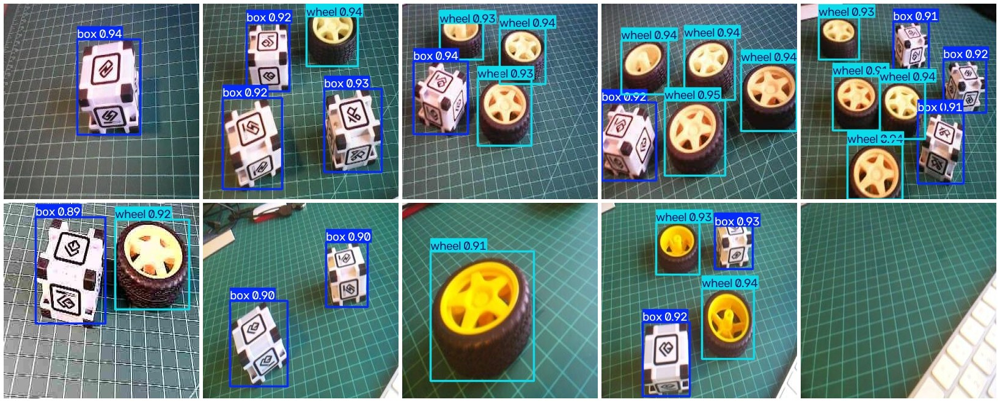
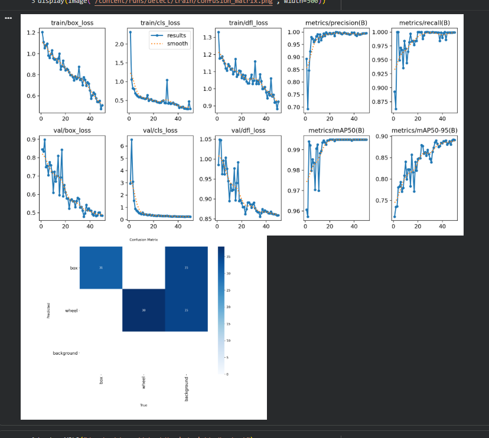
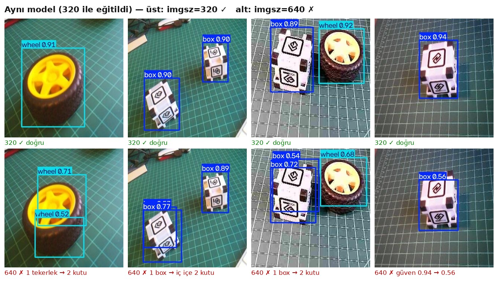
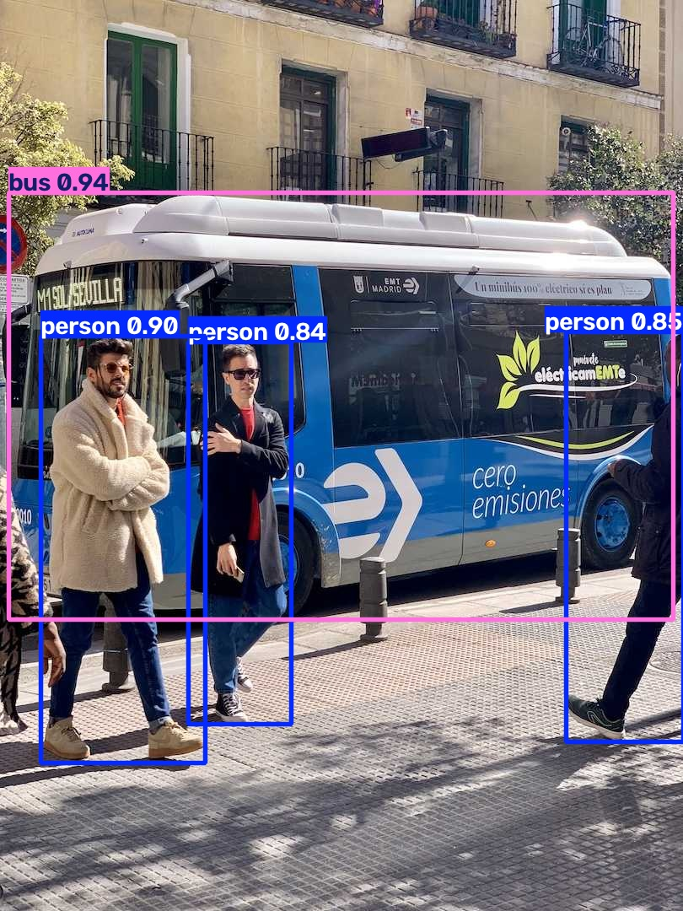
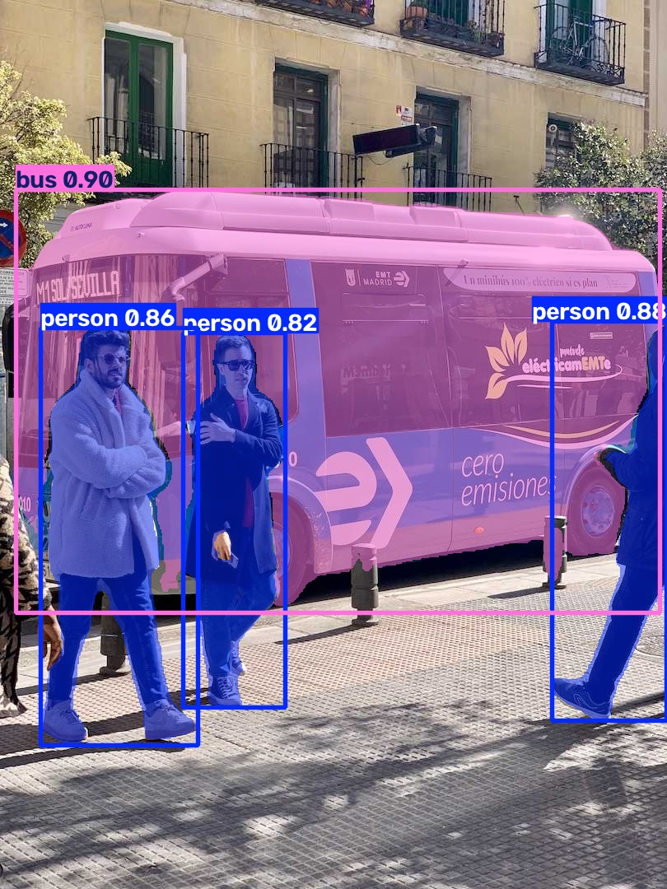
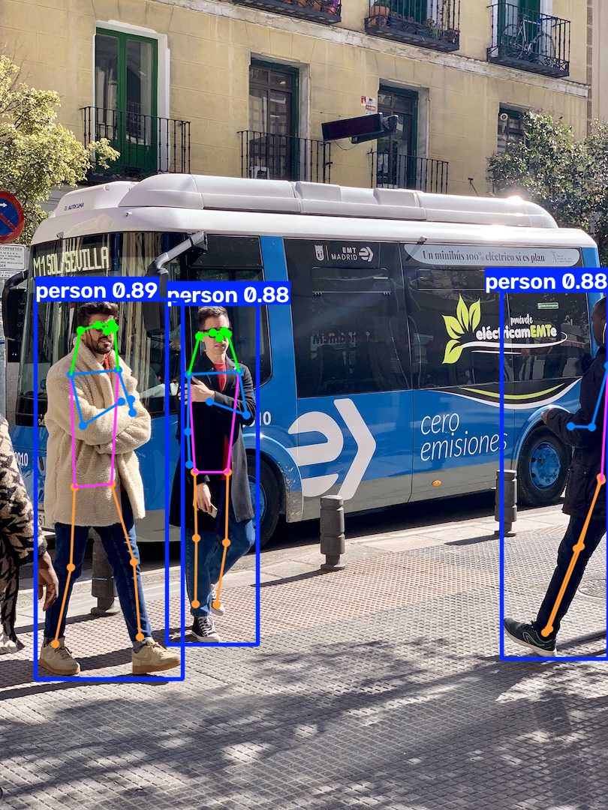

# 🚀 Raspberry Pi 5 — YOLO11: Colab'da Eğit, NCNN ile 61 FPS'te Çalıştır

**YOLO11n'i kendi veri setimle (box vs wheel) Google Colab GPU'sunda eğittim, modeli Raspberry Pi 5'e taşıyıp NCNN'ye çevirdim: çıkarım 103 ms → 14.6 ms (×7.1), sonuçlar birebir aynı. Ayrıca imgsz kuralı bozulunca modelin nasıl "sessizce" bozulduğunu deneyle gösterdim.**
Edge AI serisinin 6. bölümü.

-C51A4A?logo=raspberrypi&logoColor=white)


<p align="center">
  <br>
  <i>Modelin hiç görmediği 10 test resmi — Pi 5'te, imgsz=320, conf=0.5. Son resim boş masa: model doğru şekilde sessiz kaldı.</i>
</p>

---

## 🎯 Ne yaptım?

```
Roboflow Universe        Google Colab (T4 GPU)              Raspberry Pi 5 (CPU)
Box vs Wheel v8   ──▶    YOLO11n · 50 epoch · imgsz=320 ──▶ best.pt ──export──▶ NCNN
225/13/10 resim          ~2 dakika · mAP50 0.995      scp   103 ms           14.6 ms · 61 FPS
```

1. **YOLO'yu tanıdım:** YOLOv8n / YOLO11n / YOLO26n'i PyTorch, NCNN ve ONNX formatlarında Pi 5'te ölçtüm; detect, segment, pose ve classify görevlerini denedim.
2. **Kendi dedektörümü eğittim:** Transfer learning ile YOLO11n → 2 sınıf (box, wheel).
3. **Deploy ettim ve doğruladım:** Pi'de PyTorch → NCNN, hem **hız** hem **doğruluk** karşılaştırması.

---

## 📊 Sonuçlar

### Eğitim (Colab, T4) — doğrulama kümesi
| Sınıf | Nesne | Precision | Recall | mAP50 | mAP50-95 |
|---|---|---|---|---|---|
| **all** | 69 | 0.995 | 0.999 | **0.995** | **0.897** |
| box | 31 | 1.000 | 0.998 | 0.995 | 0.897 |
| wheel | 38 | 0.989 | 1.000 | 0.995 | 0.897 |

<p align="center"></p>

### Pi 5'te PyTorch vs NCNN (imgsz=320, 30 ölçüm, ısınmalı)
| Model | pre | **inference** | post | toplam | **FPS** |
|---|---|---|---|---|---|
| PyTorch `.pt` | 0.7 ms | 103.0 ms | 0.9 ms | 104.6 ms | 9.6 |
| **NCNN** | 0.7 ms | **14.6 ms** | 1.0 ms | **16.3 ms** | **61.4** 🚀 |

✅ **10/10 test resminde nesne sayıları aynı**, skor farkı ≤ 0.01 (fp16 `.pt` ile fp32 NCNN arasındaki yuvarlama).
📐 Çıkarım ×7.1 hızlandı ama toplam ×6.4 — **Amdahl yasası**: hızlanmayan pre+post artık toplamın %10'u.

### ⚠️ imgsz kuralı: 320 ile eğitilmiş modeli 640'ta çalıştırınca
| | imgsz=320 ✅ | imgsz=640 ❌ |
|---|---|---|
| Süre | 101 ms | 385 ms (×3.8) |
| Güven | 0.89–0.95 | 0.52–0.93 |
| Tespit | 14 box, 16 wheel | 16 box, 17 wheel → **3 hayalet kutu** |

<p align="center">
  <br>
  <i>Nesneler 2 kat büyüyünce parçaları (jant, lastik) "bütün nesne" boyutuna yaklaşıyor → bir tekerleğe iki kutu. Parça kutular az örtüştüğü için NMS de silemiyor.</i>
</p>

**Kural:** `eğitim imgsz = export imgsz = çıkarım imgsz`. Bu hata sessizdir: program çökmez, sadece sonuçlar bozulur.

### Güven eşiği: aynı model, iki confusion matrix
| | conf=0.001 (val varsayılanı) | conf=0.5 (çalışma noktası) |
|---|---|---|
| Yanlış alarm | ~70 | **0** |
| Kaçırılan nesne | 0 | 1 |

➡️ **Precision–recall takası.** mAP düşük eşikle raporlanır; uygulama kendi eşiğini seçer.

### YOLO ailesi ve formatlar (COCO modelleri, `bus.jpg`, 640×640)
| Model | PyTorch | **NCNN** | ONNX | Hızlanma (NCNN) |
|---|---|---|---|---|
| YOLOv8n | 308.8 ms | **71.8 ms** | — | ×4.3 |
| YOLO11n | 293.0 ms | **69.9 ms** | — | ×4.2 |
| YOLO26n | 270.3 ms | **66.1 ms** | 125.0 ms | ×4.1 |

### YOLO görevleri (COCO modelleri, `bus.jpg`)
| detect | segment | pose | classify |
|---|---|---|---|
| 293 ms | 433 ms | 330 ms (17 eklem) | 49 ms (minibus %57) |

<p align="center">
    <br>
  <i>detect · segment · pose</i>
</p>

---

## 🔍 Modelin içi (NCNN export)

| | Değer | Anlamı |
|---|---|---|
| Giriş | `(1, 3, 320, 320)` BCHW | Kanal önde (LiteRT NHWC idi) |
| Çıkış | `(1, 6, 2100)` | 6 = 4 kutu + 2 sınıf · 2100 = 40² + 20² + 10² aday (stride 8/16/32) |
| Hesap | 1.6 GFLOPs | 640'ta 6.4 (×4) |
| Ağırlık | 10 MB fp32 | `.pt` 5.3 MB çünkü fp16 saklanıyor |
| `end2end` | false | YOLO11 NMS gerektirir (YOLO26 gerektirmez) |

---

## 📁 Repo yapısı

```
├── 06-yolo-raspberry-pi.md          # 📘 Ders notu: kurulum → eğitim → log okuma → imgsz deneyi → NCNN → benchmark
├── yolo-sifirdan-kahramana.md       # 🦸 YOLO teorisi baştan sona: ızgara, anchor-free, 8400, loss, NMS, export
├── notebooks/
│   └── yolo11_box_vs_wheel_colab.ipynb   # Colab eğitim defteri (API anahtarı Secrets'tan)
├── models/
│   ├── box_wheel_320_yolo11n.pt               # Eğitilmiş model (fp16, 5.3 MB)
│   └── box_wheel_320_yolo11n_ncnn_model/      # NCNN (param + bin + metadata)
├── bench_yolo.py            # YOLOv8n/11n/26n × PyTorch/NCNN/ONNX hız karşılaştırması
├── explore_results.py       # Results nesnesinin içi: xyxy, xyxyn, conf, cls...
├── yolo_tasks.py            # segment · pose · classify
├── predict_box_wheel.py     # Kendi modelim, test resimleri: python predict_box_wheel.py [imgsz]
├── bench_box_wheel.py       # PyTorch vs NCNN: hız + doğruluk
├── manual_ncnn_decode.py    # 🦸 Ultralytics'siz: ncnn + numpy ile letterbox → (1,6,2100) çözme → NMS
└── assets/                  # README görselleri
```

---

## ⚡ Hızlı başlangıç (Raspberry Pi 5)

```bash
# 1) Ortam — ÖNEMLİ: torch'u ultralytics'ten ÖNCE ve CPU index'ten kur (yoksa ~3 GB CUDA paketi iner)
python -m venv ~/yolo --system-site-packages && source ~/yolo/bin/activate
pip install torch torchvision --index-url https://download.pytorch.org/whl/cpu
pip install ultralytics

# 2) Repo
git clone https://github.com/ebrarklc/raspberry-pi5-yolo-custom-detector.git
cd raspberry-pi5-yolo-custom-detector

# 3) Test resimleri: notebook'un son hücresi box_wheel_test.zip üretir
unzip box_wheel_test.zip -d images/box_wheel_test

# 4) Çalıştır
python predict_box_wheel.py          # PyTorch, imgsz=320
python bench_box_wheel.py            # PyTorch vs NCNN
yolo predict task=detect model=models/box_wheel_320_yolo11n_ncnn_model imgsz=320 source=images/box_wheel_test
```

**Kendi modelini eğitmek için:** `notebooks/yolo11_box_vs_wheel_colab.ipynb` → Colab'da aç → T4 GPU → Roboflow API anahtarını **🔑 Secrets**'a `ROBOFLOW_API_KEY` olarak ekle.

---

## 🧠 Öğrenilen dersler

| Durum | Ders |
|---|---|
| `pip install ultralytics` 3 GB NVIDIA paketi indirdi | Donanıma özel paketi (CPU torch) **önce** kur |
| 1. epoch'ta mAP50 = 0.961 | **Transfer learning** — COCO'nun "görme" bilgisi taşındı (`Transferred 493/499`) |
| mAP50 epoch 3'te doydu, mAP50-95 sona kadar arttı | Model önce nesneyi **bulmayı**, sonra kutuyu **sıkılaştırmayı** öğrendi |
| Confusion matrix'te ~70 yanlış alarm, ama P=0.995 | Metrikler **hangi eşikte** ölçüldü? conf=0.001 vs 0.5 |
| 640'ta bir tekerleğe iki kutu | **imgsz kuralı** — ölçek uyuşmazlığı parça kutular üretir |
| Pi'de süre nesne sayısından bağımsız (~101 ms) | Model her zaman 2100 adayı hesaplar → öngörülebilir gecikme |
| NCNN ×7.1 ama sistem ×6.4 | **Amdahl yasası** — darboğaz kayar |
| NCNN 640'ta ×4, 320'de ×7 | Hızlanma oranı model/giriş/donanıma bağlı — **kendi donanımında ölç** |
| `runs/detect/runs/...` | Ultralytics'e **mutlak** `project` yolu ver |
| Roboflow kodu API anahtarı içeriyor | Anahtar GitHub'a, ekran görüntüsüne, açık linke **asla** |

---

## 🚀 Geliştirme fikirleri
- [ ] Kendi topladığım veriyle eğitim (Proje 3: kamera modülü vs Pi kutusu)
- [ ] Picamera2 ile **canlı** NCNN tespiti + Flask akışı
- [ ] **int8 quantization** ve doğruluk kaybının ölçülmesi
- [ ] Tracking ile nesne **sayma** (Bölüm 7)
- [ ] YOLO26n ile aynı veri setinde eğitim (NMS'siz) ve karşılaştırma

---

## 🗺️ Edge AI serisi

| # | Bölüm | Repo |
|---|---|---|
| 1 | Raspberry Pi 5 kurulumu | [raspberry-pi5-edge-ai-setup](https://github.com/ebrarklc/raspberry-pi5-edge-ai-setup) |
| 2 | Görüntü sınıflandırma temelleri | [raspberry-pi5-image-classification-litert](https://github.com/ebrarklc/raspberry-pi5-image-classification-litert) |
| 3 | 🏆 Kendi görüntü sınıflandırıcım | [raspberry-pi5-custom-image-classifier](https://github.com/ebrarklc/raspberry-pi5-custom-image-classifier) |
| 4 | 🏆 Nesne tespiti | [raspberry-pi5-object-detection](https://github.com/ebrarklc/raspberry-pi5-object-detection) |
| 5 | Özel nesne tespiti (Edge Impulse) | *yakında* |
| 6 | 🚀 YOLO: eğit ve deploy et | 📍 *bu repo* |

---

## 📚 Kaynaklar
- Marcelo Rovai — *Edge AI Engineering: Hands-On with the Raspberry Pi* (UNIFEI, 2026), s. 218–262
- Redmon et al. (2016) — *You Only Look Once: Unified, Real-Time Object Detection*
- [Ultralytics YOLO dokümantasyonu](https://docs.ultralytics.com) · [NCNN](https://github.com/Tencent/ncnn)
- Veri seti: [Roboflow Universe — Box versus Wheel (Marcelo Rovai)](https://universe.roboflow.com/marcelo-rovai-riila/box-versus-wheel-auto-dataset)

> ⚖️ Ultralytics modelleri **AGPL-3.0** lisanslıdır.

## 👤 Hazırlayan
**Ebrar Kılıç** — Edge AI & Embedded Systems · [github.com/ebrarklc](https://github.com/ebrarklc)
